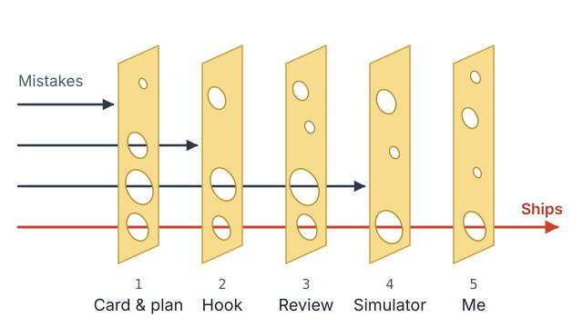

## The problem with fast

AI coding agents are fast. Give one a vague request and it will happily write a few hundred lines, tell you it's done, and be wrong in ways you won't notice until a user does. Speed isn't the hard part any more. Knowing the change is right is.

So for Bogha, my archery training app for iPhone and Apple Watch, I stopped asking "how do I get the agent to write more?" and started asking "what would make me trust what it writes?"

## Swiss cheese

My answer is borrowed from aviation safety. The Swiss cheese model treats every defence as a slice of cheese. Each slice has holes, and things only go wrong when the holes in every slice line up. You don't need a perfect slice. You need enough slices with their holes in different places.

Every step in how I build Bogha is a slice. At each one, either I or the agent gets a chance to catch a mistake, fix the context the agent is working from, or correct an assumption before it turns into code. No single step is trusted on its own: not the tests, not the review, not even me.

  

Stack enough of them and the pipeline can build complex features, as long as what goes in at the top is right. Here are the slices, in order.

## Slice 1: the card and the plan

Every piece of work is a card: a small markdown file with a type, a status and a link to its spec. An agent picks up the top ready card, writes a plan, and stops. Nothing gets built until I've read the plan and said yes.

The exception is small, well-defined cards that almost certainly don't need me at the plan stage. Those can run unattended in a batch, which is a post of its own.

The card is the unit of everything: one card per branch, and commits carry a `Card:` trailer so I can find a card's whole history later. When a defect turns up halfway through, it doesn't get fixed quietly in the same branch. It gets its own card.

## Slice 2: a hook that says no

The rule that changed the most is the simplest: **no production code without a failing test first.**

Agents are very good at agreeing with a rule and then not following it, so I don't ask. A hook refuses any edit to production Swift until a test file has changed since the last commit. A commit that touches production code without a test needs an explicit `No-Test:` reason in its message, and that reason gets logged on the card.

Every bug fix comes with a regression test, and the test has to be proven: put the bug back, watch the test fail, take it out again.

## Slice 3: review

Once the build is done, a review pass checks the branch against the project's own rules: the domain docs, the spec, and the shapes the codebase already uses. It fixes what it safely can, test-first, and stops to ask about the rest.

## Slice 4: the simulator

Then the agent runs the app on a simulator, works through the checks listed for the change, and gives me a verdict: low risk and fine to merge, or needs a real device.

## Slice 5: me

Either way the call is mine. When the verdict says a real device is needed, I get a short checklist of only what the simulator couldn't prove, and I work through it on my phone, and on my watch when the change touches it. Only my answer merges a card.

## What a hole looks like

Passing tests aren't proof the app works. Bogha syncs through SwiftData and CloudKit, and in September a change renamed a stored property. It compiled, passed both test suites, and then failed to open every existing store. The tests never saw it because they start from an empty in-memory store. The iPhone app quietly fell back to one too and looked healthy; only the watch crashed.

The tests had a hole. The plan didn't: it said to open the app over data saved by the old version, and that caught it before it merged. That's now a rule for every schema change, and QA treats any change to the model or sync code as high risk, so it needs a real device before it merges.

## What the numbers say, and what they don't

In the eight weeks since I started working this way, Bogha has shipped 166 cards: 34 features, 40 defects, and the rest chores and QA. Most features shipped within a day of being started. Device QA sent three cards back, and none of the three was a bug: each time, I'd changed my mind about what I wanted once I had it in my hand.

That reads like a success story. It isn't one yet. Bogha is an unreleased prototype that I build in my spare time, so QA has been lenient, and nothing in the pipeline checks design or UX well enough. The code works, but the features don't always fit together and parts of it need a refactor. The slices are good at making sure what gets built works. They can't tell me whether it was the right thing to build. That's a post of its own.

## What I'd tell you to steal

- Don't trust any single check, including yourself. Stack them.
- Make the unit of work small and written down before any code exists.
- Enforce rules with tooling, not with a prompt.
- Treat "the tests pass" as necessary, not sufficient: run the real thing.
- Keep the merge decision human.

None of these slices are specific to Bogha, but the way they fit together is. Bogha isn't deployed when a branch merges, so a card can wait for me. A web service that deploys on every push has no such gap, and its checks have to finish before the merge. A product with real users needs a design slice I don't have yet. The pipeline has to fit the project and how it ships.

If your team is bringing agents into how it builds software, or already has and isn't sure it can trust what ships, [get in touch](#contact-heading). I can set up a pipeline that fits your stack, or review the one you have.
